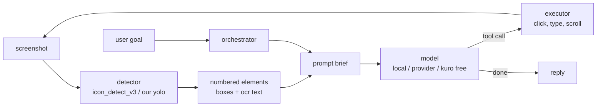

# kuro pc agent - logic

> **heads up:** this is not the final design. we're still bug testing and the
> algorithms (detection thresholds, orchestration rules, prompt budget, etc.)
> change pretty much every week. treat everything here as a snapshot.

the raw logic behind the kuro pc agent: the vision side that figures out what's
clickable on a screen, and the backend that plans a turn, picks tools and runs
the model.

```
vision/     ui labeler, omniparser detector wrapper, dataset builder, evals
backend/    kuro rust workspace (core, server, cli) - orchestration lives here
docs/       architecture notes + diagrams
```

## the idea

an llm can't click on pixels reliably. so instead of asking it "where is the
save button", we run a detector over the screenshot first, give every
interactive element a number, and let the model answer "click 14".



the loop keeps going until the model stops asking for tools or it hits the
round limit the orchestrator gave it.

## why it's different

- **own detector data.** stock omniparser only finds ~67% of the human-labeled
  elements on screenspot/waveui. we merge human boxes with low-threshold
  detector boxes across web, android, ios, desktop and xr (~712k boxes) to
  train a single `interactive` class.
- **effort decides the budget.** one dial (instant -> extended) sets how many
  tool rounds a turn gets, the prompt token budget, and which skills load.
- **skills come from the project**, read from `Cargo.toml` / `package.json` /
  `pyproject.toml`, not guessed from the message.
- **subagents get a clean context.** delegating "why does this test fail" runs
  a full tool loop somewhere else and only a short answer comes back.
- **permission is the mode, not a popup.** ask / plan / agent is picked before
  the turn. plan mode never even sees a write tool.
- **runs local first.** llama.cpp engine on your machine. providers and the
  free-tier pool are opt in.
- **small model friendly.** web search runs before the model answers, memory is
  preloaded, so it works even if the model is too small to call tools well.

## more

- [docs/architecture.md](docs/architecture.md) - how a turn flows, orchestration, subagents
- [docs/vision.md](docs/vision.md) - detector, dataset builder, the pc control loop

## status

- [x] detector wrapper (mps, fp16)
- [x] dataset builder + label merge
- [x] orchestration / skills / subagents
- [ ] fine-tune yolo on merged set
- [ ] screen executor (click/type) wired into the tool loop
- [ ] verify step after each action
- [ ] windows support
