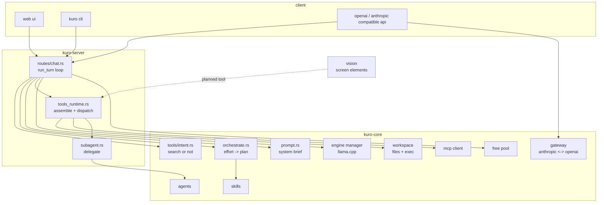
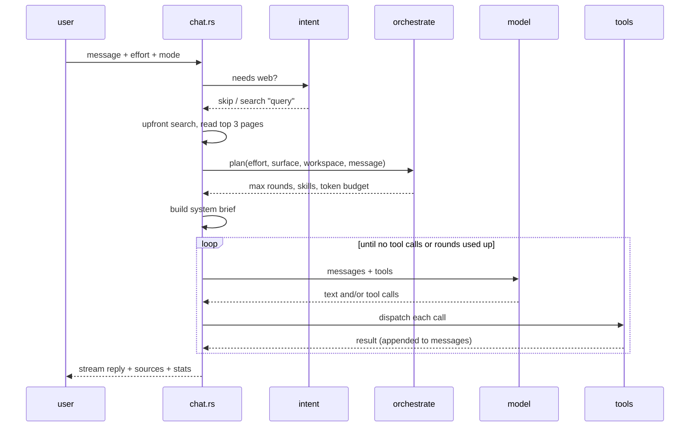
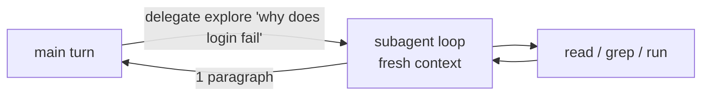

# architecture

> wip. numbers and rules below are what's in the code right now, they will move.

## big picture

## one turn

on the last round tools are not offered, so the model has to answer.

## orchestration

`kuro-core/src/orchestrate.rs`

input: effort, surface (chat or code), workspace root + mode, the message,
pinned skills. output: a `Plan`.

| effort | chat rounds | code rounds | chat budget | code budget |
|---|---:|---:|---:|---:|
| instant | 2 | 4 | 200 | 400 |
| balanced | 4 | 8 | 500 | 1000 |
| thinking | 6 | 12 | 900 | 1800 |
| extended | 8 | 16 | 1400 | 3000 |
| ultra | 8 | 40 | 1400 | 8000 |

budget = tokens of skill text allowed in the system prompt.

how skills get picked:

1. essentials always on when coding (read before edit, run the tests, ...)
2. languages from project files: `Cargo.toml` -> rust, `package.json` ->
   typescript (+ react / tailwind from deps), `pyproject.toml` -> python, etc.
   max 3.
3. keyword triggers in the message (`slow` -> performance, `why` -> debugging)
4. everything ranked, then trimmed to fit the budget. skills named in the
   message survive any trim. what got dropped is reported back.

if auto orchestration is off, it just uses the user's skills as-is and only
budgets rounds.

## subagents

`kuro-core/src/agents/mod.rs`, `kuro-server/src/routes/subagent.rs`

same model, different brief + skills, fresh context. one per kind of work:

| agent | writes | for |
|---|:---:|---|
| explore | no | figure out how something works |
| frontend | yes | ui code |
| backend | yes | handlers, schemas, services |
| debug | yes | find cause of a failure |
| test | yes | write + run tests |
| review | no | review a change |
| architect | no | design before building |
| refactor | yes | reshape without behavior change |

non-writing agents only get read tools. a subagent never gets more than the
parent workspace mode allows.

## workspace modes

| mode | can do |
|---|---|
| ask | nothing, can't see project |
| plan | read + search |
| agent | read, write, run dev commands in folder |
| bypass | agent without the command allowlist |

paths get resolved (symlinks, `..`) before the root check. `.ssh`, `.aws`,
`.env`, private keys are refused. every write keeps the old contents for undo.

## models

- local: one llama.cpp process per loaded model, supervised by `engine/manager.rs`
- providers: bring your own key (openrouter, anthropic, openai, groq, ...)
- kuro free: pool of free-tier keys, each request goes to whichever provider
  still has allowance, cooldown on 429 / quota errors
- `classify.rs` reads model ids to filter out embedders/rerankers/etc so they
  don't show up as chat models

## where the pc agent plugs in

the screen loop (see [vision.md](vision.md)) is meant to be just another tool
group in `tools_runtime.rs`: `screen_look` returns numbered elements,
`screen_act` clicks/types by element id. that way it gets the same round
limits, effort dial and mode gating as everything else. not wired yet.
