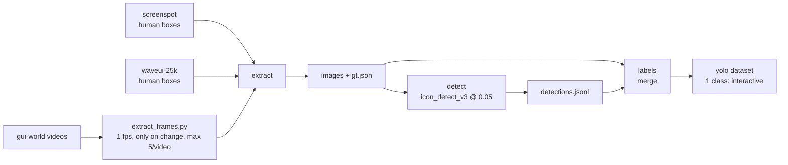
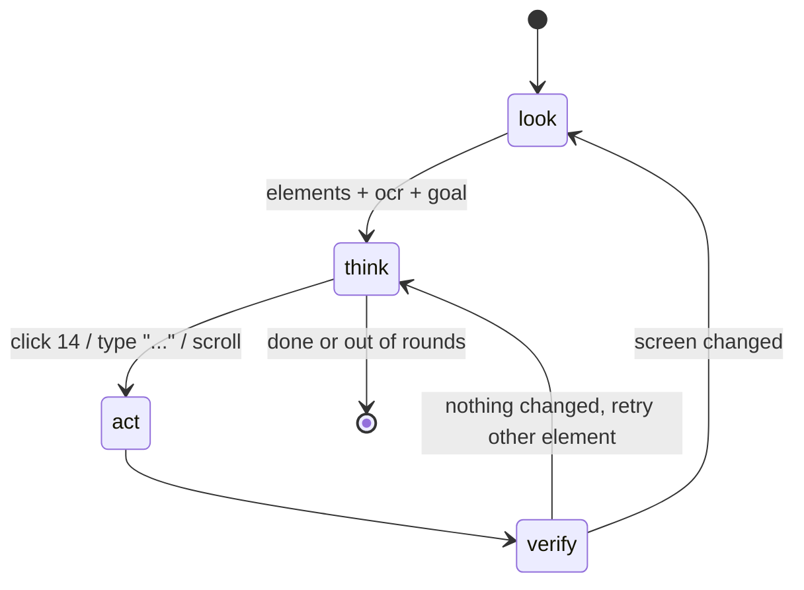

# vision

> wip. thresholds and the dataset mix are still being tuned.

## detector

`vision/scripts/detector.py`

wraps omniparser v2 `icon_detect_v3` (yolov9-e torchscript). we skip
ultralytics and decode the raw heads ourselves:

1. letterbox to 1280x1280 (gray pad)
2. run model, 3 heads at stride 8 / 16 / 32
3. each head gives a class score + ltrb distances per grid cell -> boxes
4. score cutoff (default 0.05), nms at iou 0.45, scale back, clamp

runs on mps in fp16 (~2x faster than fp32, boxes match at iou > 0.9, see
`scratch/parity.py`).

the stock model is under-confident on small stuff, which is why the cutoff is
so low.

## dataset builder

`vision/scripts/build_dataset.py`



merge rules:

- human boxes always win
- drop detector box if iou >= 0.5 with a human box
- drop detector box if it covers > 10% of screen and score < 0.2 (empty lists,
  whole windows)
- drop anything under 2px
- dedupe identical lines (waveui repeats elements per instruction)
- waveui static types (text, header, image, banner...) are left out
- screenspot goes 100% to val since it's a public benchmark
- splits are hashed per screenshot / per video so frames don't leak

current mix: 15,681 train / 2,740 val images, ~712k boxes.

detect stage is resumable, labels stage is cheap so you can re-run it with a
different `--conf`.

## evals

- `scratch/eval_recall.py` - how many human boxes the detector recovers per cutoff (~67% @ iou 0.5)
- `scratch/parity.py` - fp16 vs fp32
- `scratch/bench.py` - per image latency by batch size
- `scratch/viz.py` - draw boxes colored by confidence
- `scripts/test_build_dataset.py` - merge / yolo / split tests

## omniparser patch

`vision/omniparser-mac.patch` applies to microsoft/OmniParser to run on a mac:
drops paddleocr (easyocr only) and forces eager attention for florence-2 on cpu.

```
cd OmniParser && git apply ../kuropcagent-logic/vision/omniparser-mac.patch
```

weights aren't in this repo, grab them from the omniparser v2 hugging face page
into `vision/models/omniparser/`.

## the pc control loop (planned)

this part is the general idea, not final code:



```
goal = user message
for round in range(plan.max_rounds):
    shot = screenshot()
    els = detector(shot) + ocr(shot)       # id, box, text
    marked = draw_ids(shot, els)           # set-of-marks image
    step = model(brief, goal, els, marked)
    if step.done: break
    execute(step.action, els[step.id])     # center of box
    if not screen_changed(shot): note("no effect")
```

things we're still deciding:

- ocr: easyocr vs apple vision
- send the marked image or just the element list (small models don't do images)
- fine-tuned yolo vs stock icon_detect_v3
- how to verify an action actually worked
